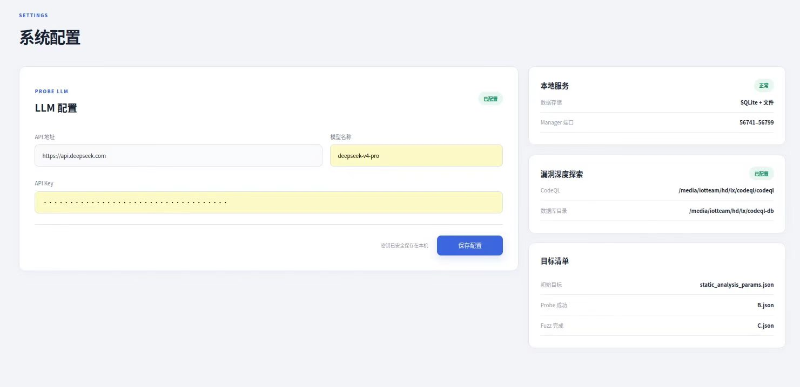
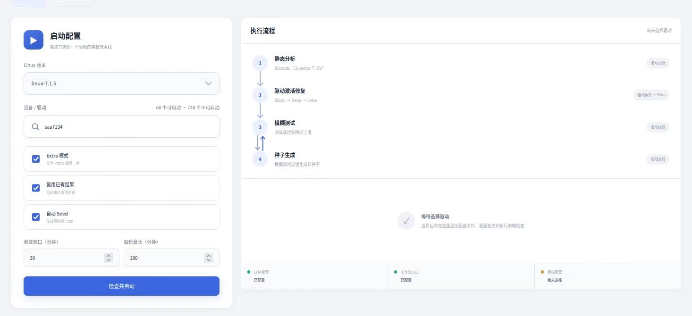
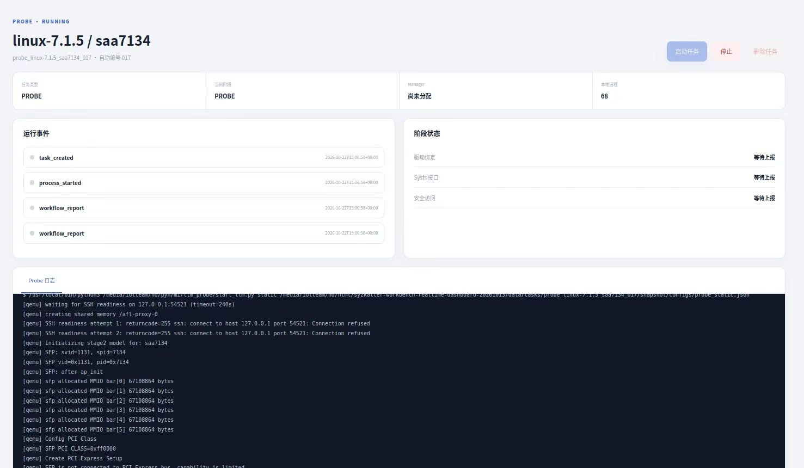

# 崇明鸟

大模型辅助的 Linux 内核全驱动漏洞挖掘系统。代码仓库：<https://github.com/dieuAZ/-Linux->。

本仓库是运行发布包，只保留 Linux 启停程序和说明资料；工作台程序及分析工具随 Docker 镜像提供。其余技术文档记录了开发过程，可能提及本发布包未附带的源码或脚本。

## 运行环境

仅支持 **Linux 宿主机**。需要安装并启动 Docker，当前用户须有执行 Docker 命令的权限。运行 Fuzz 时还需要宿主机提供 `/dev/kvm`。

## 启动与关闭

在包含这两个文件的目录运行：

```bash
./start
./stop
```

`start` 会优先启动已有的 `syzkaller-workbench` 容器，并确保网页服务可访问；没有容器时，使用本地镜像创建容器；本地也没有镜像时，自动从 `ghcr.io/dieuaz/chongmingniao:20261022` 拉取。新容器的 `/dev/shm` 为 4G。若镜像尚未设为公开，请先运行 `docker login ghcr.io`。

启动后，在宿主机浏览器打开 <http://127.0.0.1:8080>。`stop` 只停止容器，不删除容器或运行数据。已有容器会被复用，不会被自动替换；已有容器的 `/dev/shm` 无法原地调整。

## 页面操作示例：分析 `saa7134`

### 1. 配置 LLM

在左侧打开“系统配置”，在“LLM 配置”中填写 API 地址、模型名称和 API Key，点击“保存配置”。看到“已配置”后再启动需要 Probe 的流程。API Key 只在配置页面输入，不要写入 README 或提交到代码仓库。



### 2. 选择驱动并启动

打开“驱动分析与测试”→“启动配置”。Linux 版本选择 `linux-7.1.5`；在“设备 / 驱动”中搜索 `saa7134`，**再点击搜索结果选中驱动**，仅输入名称还不算完成选择。按需设置“Extra 模式”“复用已有结果”“自动 Seed”及时间参数，然后点击“检查并启动”。图示中三个选项均已勾选，收敛窗口为 30 分钟、每轮最长为 180 分钟。



### 3. 在工作台查看任务

“驱动分析与测试”页面的“运行流水线”展示整体进度：静态分析、驱动激活修复（Probe）、模糊测试；开启“自动 Seed”时，还会根据测试反馈生成种子并继续测试。勾选“复用已有结果”时，已成功的阶段可能直接复用，不会重新运行。

打开左侧“工作台”，在任务列表中找到 `linux-7.1.5 / saa7134` 并点击。任务详情会显示任务类型、运行状态、当前阶段、运行事件、阶段状态和对应日志；例如进入 Probe 阶段时，可查看“Probe 日志”及驱动绑定等阶段状态。


